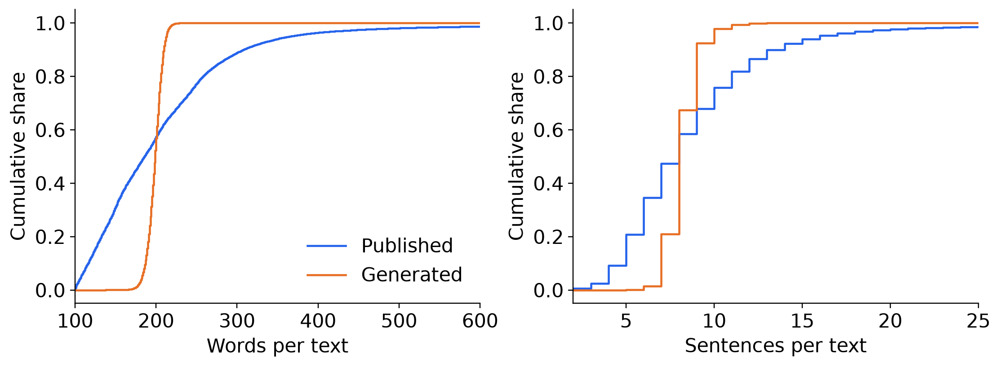
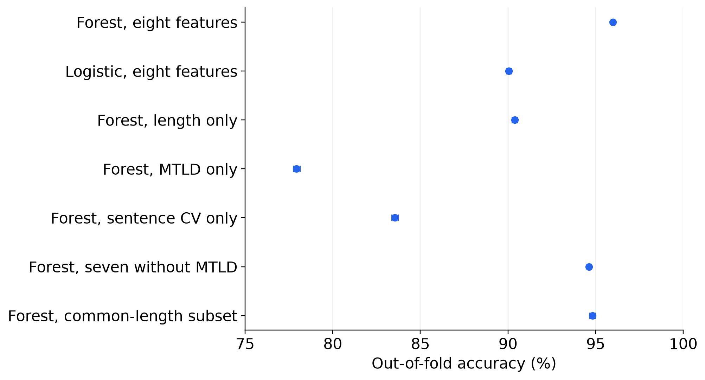
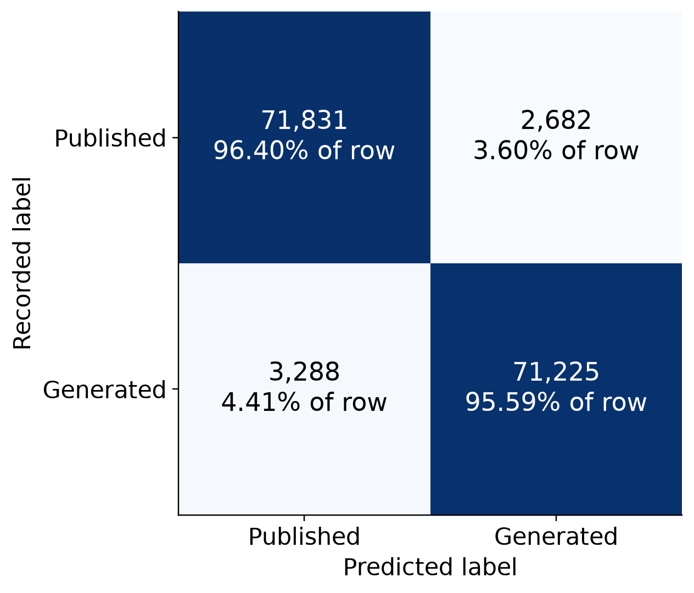
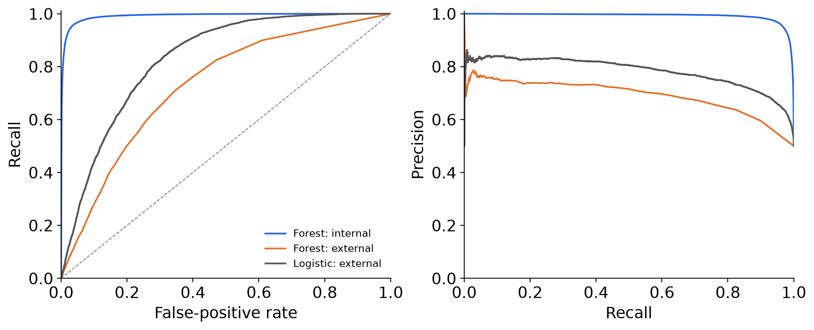

# High Accuracy, Poor Transfer: A Case Study of AI-Generated Abstract Detection

**Vedang Ratan Vatsa**

vedangvats@gmail.com

## Abstract

This study tests whether a detector that performs well on one abstract corpus retains its accuracy on another. An audit of 100,000 recorded published/generated pairs retains 74,513 pairs, or 149,026 texts, for analysis. Five-fold validation keeps detected related records together. A random forest using eight word and sentence features reaches 95.99% internal accuracy, an area under the receiver operating characteristic curve (ROC AUC) of 0.9916, and a 3.60% false-positive rate. Word and sentence counts alone reach 90.38% accuracy. At the unchanged 0.5 threshold, the forest reaches 53.89% accuracy and 11.73% generated-text recall on 8,319 eligible pairs from a separately assembled corpus. Logistic regression reaches 68.91% external accuracy. Post hoc threshold, seed, source-quality and length checks leave a large performance gap. The same fitted fold models also perform well locally and poorly externally. The results document poor transfer for this fixed procedure under the recorded labels. Incomplete source and generation records limit authorship claims, and the comparison does not identify a single cause of the gap.

_**Keywords**_: scientific abstracts, generated text, external validation, lexical diversity, sentence length, text classification

## 1. Introduction

Text detectors can learn patterns specific to their training corpus. For scientific abstracts, those patterns may reflect writing style, text length, source formatting or generation instructions. Testing on a separately assembled corpus helps determine whether a high internal score carries over to a different setting [13].

This case study examines an existing collection of published abstracts paired with title-based generated text. It audits the source records, measures eight word and sentence features, and compares a random forest with simpler baselines. It then tests the same procedure on Sivesind's independently assembled abstract corpus [12].

The central question is whether high internal accuracy survives this transfer. Length-only baselines measure discrimination from word and sentence counts. Further checks ask whether shared length ranges, decision thresholds or training choices recover the forest's accuracy. Paired comparisons show whether the models retain their relative performance across corpora.

## 2. Related Work

Gao et al. compared title- and journal-prompted ChatGPT abstracts with original medical abstracts, finding errors in both automated detection and blinded human review [1]. Desaire et al. used 20 features, including sentence-length variation, to classify paragraphs from *Science* Perspectives articles and corresponding ChatGPT essays [2]. These studies motivate compact feature-based comparisons, although their tasks and scores are not directly comparable with this abstract corpus.

Corpus composition also matters. Guo et al. compared human and ChatGPT answers in the HC3 question-answer corpus [3], while Liang et al. found higher detection error rates on non-native English writing [4]. Krishna et al. showed that paraphrasing can evade several detectors [10]. Other approaches, such as Binoculars, score text with two pretrained language models rather than word and sentence features [11].

RAID tests detectors across generators, domains, decoding choices and attacks [13]. A later shared task reports strong detection when the tested domains and generators appear in training, with per-domain thresholds targeting a 5% false-positive rate [14]. MELD uses broader generator training and content-matched scientific rewrites, and calibrates benchmark thresholds on each evaluation pool's human scores [15]. Those calibration procedures differ from transferring a fixed threshold, as tested here.

## 3. Data and Methods

### 3.1 Local corpus and source audit

The analysis uses existing local files containing 100,000 published/generated text pairs. Source records include an OpenAlex work ID, title, publication year, DOI where available, and an abstract field. OpenAlex is a scholarly metadata index [5]. The source and paired files agree on all IDs, years and published-text strings.

The *published class* consists of texts supplied as published abstracts. Some fields contain extra material, so the label does not guarantee a conventional journal abstract. Stored publication years range from 1670 to 2021. Pre-2022 dates support a presumed-human comparison, but do not establish human-only authorship. The collection history includes paginated retrieval, random-sample requests, filtering and replacements; its sampling probabilities are unknown.

The source audit queried all 100,000 IDs against OpenAlex on 5 October 2026 (UTC). DOI lookups for 85 unresolved IDs recovered 10 more records. The audit compared titles, years, DOIs and abstract text, and recorded language, work type, source type and retraction status. Abstract agreement uses Unicode, HTML-entity, whitespace and case normalization while retaining numbers and punctuation. References to current metadata mean this dated index snapshot, not independent publisher verification.

### 3.2 Generation records

Archived OpenAI scripts specify `gpt-4o-mini`, temperature 0.7 and a 400-token output limit. Two prompt variants request academic abstracts of 150-250 or about 200-300 words using only the paper title. The exact templates appear in the Supplementary Methods. Title-based generation does not give the model the original study's verified methods or findings.

The paired files lack per-output prompt assignments, provider response IDs, model snapshots, dates and finish reasons. The script settings therefore cannot be verified for each text, and the rate of token-limit truncation is unknown. All evaluations use the recorded labels.

### 3.3 Text processing and eligibility

Text preparation decodes HTML entities, applies Unicode compatibility normalization (NFKC), and collapses whitespace. A fixed Unicode token rule retains internal apostrophes, separates hyphenated terms and excludes decimal digits. Sentence boundaries use NLTK's English Punkt tables [9]. The exact token rule and resource version appear in the Supplementary Methods.

Each text needs at least 100 counted words and two sentences containing word tokens. The word cutoff limits the analysis to longer texts, and two sentences permit a measure of length variation. Records are joined by source ID, with cleaned-title agreement, exact stored published-text agreement and matching numeric years. Duplicate checks compare case-folded word-token sequences, retaining internal apostrophes but omitting decimal digits and punctuation outside tokens. This can treat texts with different numerical findings as duplicates. Duplicates are removed in source-ID order, and cross-class copies are checked before evaluation.

**Table 1. Sequential corpus accounting**

| Stage | Pairs removed | Pairs remaining |
| --- | ---: | ---: |
| Original paired records | 0 | 100,000 |
| Missing source title | 19 | 99,981 |
| Documented title-content conflict | 1 | 99,980 |
| Normalized duplicate text | 113 | 99,867 |
| Fewer than 100 words in either text | 23,501 | 76,366 |
| Fewer than two sentences in either text | 1,853 | 74,513 |

Table 1 gives the sequential exclusions, including one inspected title-content conflict. No additional pair failed source-file agreement, source-ID syntax, cross-class copy or feature-calculation checks. The final sample contains 74,513 texts per class.

### 3.4 Eight features

**Sentence length.** Mean sentence length averages the word counts of recognized sentences. The sentence-length coefficient of variation (CV) divides the population standard deviation of sentence lengths by their mean.

**Lexical diversity.** The Measure of Textual Lexical Diversity (MTLD) measures the lengths of word sequences that maintain a chosen type-token ratio [6]. The analysis uses `lexicalrichness` 0.4.1, threshold 0.72 and case-folded word tokens. It averages forward and reverse passes, including partial factors. Failed, nonfinite or nonpositive values are excluded.

**Word-list matches.** Four features count hedge, booster, self-mention and connector matches per 1,000 words. Full dictionaries appear in the methods supplement. Multiword connectors are matched within sentences, taking the longest phrase once. Uppercase abbreviations such as "US" are excluded from self-mentions; "I" remains eligible. These features count matches rather than validated rhetorical intentions.

**Sentence-opening connectors.** The eighth feature is the share of sentences whose first counted word tokens match a listed connector. Its denominator is sentence count.

### 3.5 Models and grouped evaluation

Pairs sharing a source ID, normalized title, normalized text, valid DOI or current canonical ID are connected into groups. A near-duplicate search uses word five-gram MinHash with 128 permutations, seed 42 and a candidate threshold of 0.8. Candidate texts are linked when their exact Jaccard similarity is at least 0.85. The search found 521 links, all of which stay within the final groups. The dataset contains 73,886 groups, assigned to five folds by the hash rule in the Supplementary Methods.

The primary model is a random forest [7] with 100 trees, Gini splits, square-root feature sampling, unlimited depth, minimum leaf size one, bootstrap sampling and seed 42. Forest baselines use word and sentence counts only, MTLD only, sentence CV only, or seven features excluding MTLD. Logistic regression uses all eight features with training-fold standardization, L2 regularization, C equal to one, the L-BFGS solver and a 1,000-iteration limit. Computation uses scikit-learn 1.6.1 [8]. The feature concepts and forest settings come from the existing local analysis; this reanalysis corrected extraction, eligibility and grouping errors without searching for better model settings.

Each text receives one out-of-fold prediction from a model trained without its group. Scores above 0.5 receive the generated label; ties receive the published label. Scores are not calibrated authorship probabilities.

Two subset analyses test length and source quality. The common-length analysis refits the forest where both texts have 150-250 words, retaining the group assignments. The source-consistent subset requires matching normalized titles, years and cleaned abstracts, a current English article label, and an explicit non-retracted status. Eight-feature and length-only forests are refitted on this subset.

### 3.6 External evaluation

The external dataset contains 10,000 pairs from Sivesind's ChatGPT-Research-Abstracts corpus [12], selected for its public paired texts and declared generation settings. The pinned revision appears in the Supplementary Methods. Its author reports GPT-3.5-turbo-0301 generation from titles, with requested lengths equal to the source abstracts. The analysis uses these author-supplied labels and settings.

Overlap checks compare every external pair with all 100,000 original local pairs, using normalized titles, text and the same near-duplicate rule. Exclusions remove 18 title overlaps, two text overlaps, 1,658 pairs below the word minimum and three below the sentence minimum. No other duplicate, near-overlap or feature failure adds an exclusion. The remaining 8,319 pairs contain 16,638 texts.

The eight-feature forest, length-only forest and logistic model are fitted to all 149,026 eligible local texts. External texts enter neither fitting nor scaling, model selection or primary threshold selection. The decision threshold stays at 0.5. Three within-external near-duplicate links join the pairs into 8,317 groups for uncertainty estimates. Sample sizes follow the available corpora and eligibility rules.

### 3.7 Statistics and sensitivity analyses

Metrics use the recorded labels and pooled held-out predictions. Recall is the fraction of generated texts detected; the false-positive rate (FPR) is the fraction of published texts flagged as generated. Precision is the fraction of flags that are correct, and F1 is the harmonic mean of precision and recall. ROC AUC measures ranking across thresholds; average precision summarizes precision across recall levels. Paired eligibility gives equal class counts, so accuracy equals the mean of recall and specificity.

Feature differences subtract published from generated values within each pair. Pooled Cohen's d divides the class mean difference by the square root of the average class sample variance. All reported 95% intervals use 1,000 source-group bootstrap draws, retaining all pairs in each sampled group and taking the 2.5th and 97.5th percentiles. Feature intervals are marginal, not simultaneous across all eight features. Classification intervals keep predictions fixed; paired model comparisons use the same resampled groups. They exclude uncertainty from new training corpora, disputed labels and unknown sampling bias.

The internal reanalysis is retrospective. Its feature extractor and primary external procedure were fixed before external scores were inspected. The additional sensitivity analyses below were chosen after the external result was known and are post hoc. None was preregistered.

Source out-of-fold scores select thresholds for best balanced accuracy and empirical FPR caps of 1% and 5%. The caps use the higher 99th and 95th sample quantiles with a strict greater-than rule. A separate test-label oracle finds the best single threshold on the observed external scores. Because external labels select and evaluate that threshold, it is an optimistic diagnostic. External recall at FPR caps of 1% and 5% is also descriptive rather than independently calibrated.

Further checks refit the forest with seeds 7, 42 and 2026, and refit forest and logistic models on the source-consistent subset. Fixed-score length checks restrict evaluation to pairs with both texts at 150-250 or 100-500 words. Finally, each fitted fold forest is evaluated on its local held-out fold and the external corpus. This compares identical fitted models across corpora; the five fits share training and external records.

## 4. Results

### 4.1 Corpus shape and feature differences

Local published-class texts have a median of 186 words, with an interquartile range of 141-245. Generated texts have a median of 199 words and a much narrower interquartile range of 193-205 (Figure 1). The longest retained published text contains 5,162 words. In the external corpus, published texts have a median of 234 words and an interquartile range of 168-291; generated texts have a median of 203 words and an interquartile range of 150-267.

**Table 2. Feature summaries and paired differences**

| Feature | Published mean (SD) | Generated mean (SD) | Difference, 95% interval |
| --- | ---: | ---: | ---: |
| Mean sentence length | 25.35 (14.69) | 24.46 (2.58) | -0.88 [-1.00, -0.79] |
| Sentence-length CV | 0.396 (0.173) | 0.206 (0.063) | -0.189 [-0.191, -0.188] |
| Hedge matches | 3.61 (5.43) | 5.60 (5.05) | 1.99 [1.94, 2.04] |
| Booster matches | 3.15 (4.71) | 3.49 (3.55) | 0.34 [0.29, 0.38] |
| Self-mention matches | 7.09 (10.19) | 16.09 (9.94) | 9.00 [8.92, 9.09] |
| Connector matches | 4.30 (5.22) | 6.02 (3.76) | 1.72 [1.67, 1.77] |
| Lexical diversity (MTLD) | 76.69 (28.24) | 118.90 (27.74) | 42.20 [41.94, 42.47] |
| Connector opener ratio | 0.043 (0.080) | 0.100 (0.066) | 0.056 [0.055, 0.057] |

SD denotes the sample standard deviation. The four match densities use counts per 1,000 words. CV and the opener ratio are dimensionless. Differences subtract the published value from the generated value within each pair before rounding.

Generated texts have higher MTLD and lower sentence-length CV, with pooled standardized differences of 1.51 and -1.46 respectively (Table 2). Self-mention matches are also more frequent. The booster difference is small, with d equal to 0.08. These describe the recorded classes and do not establish differences in writing intent or confidence.

### 4.2 Classification and length controls

**Table 3. Source-group out-of-fold classification**

| Model | Texts | Accuracy | ROC AUC | False-positive rate |
| --- | ---: | ---: | ---: | ---: |
| Forest, eight features | 149,026 | 95.99% | 0.9916 | 3.60% |
| Logistic, eight features | 149,026 | 90.06% | 0.9594 | 11.36% |
| Forest, length only | 149,026 | 90.38% | 0.9502 | 14.74% |
| Forest, MTLD only | 149,026 | 77.93% | 0.8596 | 22.60% |
| Forest, sentence CV only | 149,026 | 83.54% | 0.8948 | 19.99% |
| Forest, seven without MTLD | 149,026 | 94.62% | 0.9860 | 5.15% |
| Forest, common-length subset | 69,746 | 94.82% | 0.9870 | 4.81% |

The eight-feature forest's conditional 95% accuracy interval is 95.89% to 96.09%. Its precision is 96.37%, recall is 95.59%, F1 is 0.9598, and average precision is 0.9906. The FPR interval is 3.47% to 3.73%.

Length alone classifies over nine in ten local texts correctly (Table 3). The narrow generated-length distribution provides useful class information, although the full feature set performs better. Figure 2 compares the internal model conditions.

Restricting both texts to 150-250 words leaves 34,873 pairs. The refitted forest reaches 94.82% accuracy, with a conditional interval of 94.65% to 94.99%. This comparison changes both the training and evaluation samples, so it does not isolate length's contribution.

Removing MTLD lowers accuracy to 94.62%. Mean Gini importance is highest for sentence CV at 0.3118, followed by MTLD at 0.2206. These split statistics describe feature use during training; the feature-removal result more directly tests predictive contribution.

### 4.3 False alarms

The forest correctly classifies 71,831 published texts and 71,225 generated texts. It flags 2,682 published texts as generated and misses 3,288 generated texts (Figure 3).

Lower prevalence can greatly reduce the precision of generated-text flags. In a hypothetical set of 10,000 texts with 100 generated records, the internal recall and FPR imply about 96 generated texts and 356 published texts flagged. Only about 21% of flags are correct under that assumption. The example assumes 1% prevalence and unchanged error rates; neither is an estimate of real deployment conditions.

### 4.4 Source consistency and text quality

**Table 4. Comparison with current OpenAlex records**

| Check | All 100,000 records | Retained 74,513 records |
| --- | ---: | ---: |
| Current record retrieved | 98,907 | 73,968 |
| Title agrees after normalization | 94,469 | 70,535 |
| Publication year agrees | 98,803 | 73,891 |
| Abstract agrees after text cleaning | 88,877 | 66,605 |
| Current language is English | 98,696 | 73,848 |
| Current type is article | 86,980 | 65,412 |
| Meets all source-consistency conditions | 74,896 | 56,355 |
| Current record unresolved | 1,093 | 545 |

OpenAlex returned 98,907 of the 100,000 original records (Table 4). The retained set includes 5,134 records now typed as conference papers and 654 typed as book reviews. Current records mark 31 retained works as retracted. These are index classifications, and differences from stored records may reflect later updates.

The source-consistent subset contains 56,355 pairs. Its eight-feature forest reaches 95.92% accuracy and a 3.71% FPR; the length-only forest reaches 90.26% accuracy. High internal separation persists after this restriction.

An offline langid check flags 612 published texts and 309 generated texts as non-English at a normalized score of at least 0.9. These are diagnostic labels, not verified writer-language information. HTML-like tags occur in 1,371 published and 492 generated texts, and URLs in 3,713 published and 25 generated texts. Source formatting differs between the classes.

### 4.5 External transfer

**Table 5. Frozen-model evaluation on 16,638 external texts**

| Model | Accuracy | Generated-text recall | False-positive rate | ROC AUC |
| --- | ---: | ---: | ---: | ---: |
| Forest, eight features | 53.89% | 11.73% | 3.94% | 0.7296 |
| Forest, length only | 51.60% | 15.18% | 11.98% | 0.5444 |
| Logistic, eight features | 68.91% | 49.79% | 11.97% | 0.8310 |

The forest correctly labels 7,991 of 8,319 external published texts, but only 976 of 8,319 generated texts. It misses 7,343 generated texts and wrongly flags 328 published texts. Its conditional 95% accuracy interval is 53.50% to 54.25%. The point estimate is 3.89 percentage points above the 50% constant-class baseline.

The external AUC of 0.7296 shows that the forest retains ranking information despite its low recall at 0.5. Logistic regression has higher external accuracy and AUC, with more false alarms at that threshold (Table 5). Figure 4 compares their score curves. Section 4.6 examines alternative thresholds.

### 4.6 Sensitivity analyses

**Table 6. Forest thresholds chosen from source scores only, except the unchanged default**

| Source rule | Threshold | Source FPR | External accuracy | External recall | External FPR |
| --- | ---: | ---: | ---: | ---: | ---: |
| Fixed default | 0.50 | 3.60% | 53.89% | 11.73% | 3.94% |
| Best source balanced accuracy | 0.49 | 3.72% | 53.99% | 12.09% | 4.11% |
| Source false positives at most 1% | 0.85 | 0.98% | 51.30% | 3.68% | 1.07% |
| Source false positives at most 5% | 0.41 | 4.85% | 55.01% | 15.15% | 5.12% |

The source-selected thresholds yield external accuracies of 51.30%-55.01% (Table 6). External FPR point estimates of 1.07% and 5.12% are close to the nominal source caps, while generated-text recall remains low.

Choosing the forest threshold with external labels raises accuracy to 68.17% at 0.03, with 70.91% recall and a 34.57% false-positive rate. Even this optimistic test-label oracle falls well below internal accuracy. It gives the best observed result for single thresholds on these fixed scores, not a validated operating rule.

**Table 7. Further forest checks at the unchanged 0.5 threshold**

| Forest check | Training pairs | External pairs | Accuracy | Recall | ROC AUC |
| --- | ---: | ---: | ---: | ---: | ---: |
| Full source, seed 42 | 74,513 | 8,319 | 53.89% | 11.73% | 0.7296 |
| Full source, seed 7 | 74,513 | 8,319 | 53.91% | 11.70% | 0.7302 |
| Full source, seed 2026 | 74,513 | 8,319 | 53.88% | 11.78% | 0.7313 |
| Source-consistent training | 56,355 | 8,319 | 53.85% | 11.54% | 0.7314 |
| Fixed scores, 150-250 words | 74,513 | 2,571 | 57.35% | 25.05% | 0.7039 |
| Fixed scores, 100-500 words | 74,513 | 8,298 | 53.89% | 11.73% | 0.7295 |

The tested seeds and source-consistency restriction leave external forest accuracy near 54% (Table 7). Source-consistent logistic regression reaches 69.38% accuracy. The seed-42 refit reproduces the primary external scores within 1e-12.

Using fixed full-procedure scores on the 150-250-word pairs gives 94.86% local accuracy and 57.35% external accuracy. The gap persists within this shared range. The 94.86% local result differs from Table 3's 94.82%, where the model was refitted within the range. Neither restriction exactly matches the length distributions.

The five same-fitted-model comparisons give local accuracies of 95.79%-96.19% and external accuracies of 53.70%-53.98%. Each refitted local score vector matches its saved held-out scores within 1e-12. The larger full-source fit is therefore not necessary for the contrast. These comparisons share records and are not independent replications.

**Table 8. Paired model differences at 0.5, with ranking comparison**

| Logistic minus forest | Difference | Conditional 95% interval |
| --- | ---: | ---: |
| Internal accuracy (percentage points) | -5.94 | [-6.08, -5.80] |
| External accuracy (percentage points) | 15.01 | [14.36, 15.63] |
| External recall (percentage points) | 38.06 | [36.95, 39.11] |
| External false-positive rate (percentage points) | 8.03 | [7.32, 8.68] |
| External ROC AUC | 0.1013 | [0.0958, 0.1066] |

The accuracy ranking reverses between corpora (Table 8). Logistic regression also has higher external AUC. Under an empirical external FPR cap of 5%, forest recall is 14.29% at 4.86% FPR, versus logistic recall of 24.45% at 4.98% FPR. At a 1% cap, recalls are 3.40% and 4.96% respectively. These points use external labels to choose thresholds and describe the observed score curves.

## 5. Discussion and Limitations

The forest separates the recorded local classes well, including after source-quality and length restrictions, but misses most external generated texts at its default threshold. The threshold oracle improves accuracy at the cost of many more false alarms. Logistic regression retains more external ranking information despite lower internal accuracy. Together, these results show why model choice, operating threshold and external evaluation matter even when internal scores are high [13, 14, 15].

The corpora differ in reported generator, prompts, requested lengths, source composition and formatting. Local generated texts occupy a particularly narrow length range. These differences offer plausible explanations for the gap, but the comparison cannot isolate their effects. Title-based generation also allows content differences because the model lacks the source study's verified findings.

The main limits concern provenance and coverage. Current-index agreement does not authenticate every publisher abstract, and generation records do not verify each output's origin or configuration. The external labels also come from the dataset's author. Paired eligibility excludes short texts, and unknown sampling probabilities limit population claims. English sentence segmentation and dictionary matches have not been validated across this corpus by an independent annotation study.

Grouping controls the detected links, but the near-duplicate search can miss others. Author identities were not retrieved. Source names were available but not used to construct folds, so author- and journal-disjoint performance remains untested. Generator-training overlap and human-edited outputs are also unmeasured. The post hoc analyses reuse one external corpus and cannot replace fresh transfer tests.

The observed errors and provenance limits do not support using this classifier to decide an individual's authorship or misconduct. Further work needs documented generation records, verified source texts and prospectively selected external corpora. Content-controlled generation and separate calibration data could help distinguish writing-process effects from corpus construction.

## 6. Conclusion

The eight-feature forest reached 95.99% internal accuracy but 53.89% external accuracy and 11.73% generated-text recall at the fixed threshold. The gap persisted across the tested thresholds, seeds, source restrictions, length ranges and identical fitted models. Logistic regression had higher external accuracy and AUC, with more false alarms at 0.5. This case shows that high internal accuracy can coexist with poor transfer. Its conclusions apply to the evaluated procedure and recorded labels.

## 7. Data and Code Availability

The external corpus is available from its original provider [12]. Local raw texts are not publicly released, and original generation logs are unavailable. A local reproduction package contains features, group assignments, predictions, settings and code for recalculating metrics and refitting the main forest. The package has not been deposited in a public archive. The methods supplement lists the dictionaries, prompt templates, resource versions and artifact locations.

AI assistance was used for programming and manuscript revision.

## 8. References

[1] Gao, C. A., Howard, F. M., Markov, N. S., Dyer, E. C., Ramesh, S., Luo, Y., and Pearson, A. T. (2023). Comparing scientific abstracts generated by ChatGPT to real abstracts with detectors and blinded human reviewers. *npj Digital Medicine*, 6, 75. [nature.com/articles/s41746-023-00819-6](https://www.nature.com/articles/s41746-023-00819-6).

[2] Desaire, H., Chua, A. E., Isom, M., Jarosova, R., and Hua, D. (2023). Distinguishing academic science writing from humans or ChatGPT with over 99% accuracy using off-the-shelf machine learning tools. *Cell Reports Physical Science*, 4(6), 101426. [pmc.ncbi.nlm.nih.gov/articles/PMC10328544](https://pmc.ncbi.nlm.nih.gov/articles/PMC10328544/).

[3] Guo, B., Zhang, X., Wang, Z., Jiang, M., Nie, J., Ding, Y., Yue, J., and Wu, Y. (2023). How Close is ChatGPT to Human Experts? Comparison Corpus, Evaluation, and Detection. *arXiv*, 2301.07597. [arxiv.org/abs/2301.07597](https://arxiv.org/abs/2301.07597).

[4] Liang, W., Yuksekgonul, M., Mao, Y., Wu, E., and Zou, J. (2023). GPT detectors are biased against non-native English writers. *Patterns*, 4(7), 100779. [arxiv.org/abs/2304.02819](https://arxiv.org/abs/2304.02819).

[5] Priem, J., Piwowar, H., and Orr, R. (2022). OpenAlex: A fully-open index of scholarly works, authors, venues, institutions, and concepts. *arXiv*, 2205.01833. [arxiv.org/abs/2205.01833](https://arxiv.org/abs/2205.01833).

[6] McCarthy, P. M., and Jarvis, S. (2010). MTLD, vocd-D, and HD-D: A validation study of sophisticated approaches to lexical diversity assessment. *Behavior Research Methods*, 42(2), 381-392. [doi.org/10.3758/BRM.42.2.381](https://doi.org/10.3758/BRM.42.2.381).

[7] Breiman, L. (2001). Random Forests. *Machine Learning*, 45(1), 5-32. [doi.org/10.1023/A:1010933404324](https://doi.org/10.1023/A:1010933404324).

[8] Pedregosa, F., et al. (2011). Scikit-learn: Machine Learning in Python. *Journal of Machine Learning Research*, 12, 2825-2830. [jmlr.org/papers/v12/pedregosa11a.html](https://jmlr.org/papers/v12/pedregosa11a.html).

[9] Kiss, T., and Strunk, J. (2006). Unsupervised Multilingual Sentence Boundary Detection. *Computational Linguistics*, 32(4), 485-525. [aclanthology.org/J06-4003](https://aclanthology.org/J06-4003/).

[10] Krishna, K., Song, Y., Karpinska, M., Wieting, J., and Iyyer, M. (2023). Paraphrasing evades detectors of AI-generated text, but retrieval is an effective defense. *Advances in Neural Information Processing Systems*, 36. [arxiv.org/abs/2303.13408](https://arxiv.org/abs/2303.13408).

[11] Hans, A., Schwarzschild, A., Cherepanova, V., Kazemi, H., Saha, A., Goldblum, M., Geiping, J., and Goldstein, T. (2024). Spotting LLMs With Binoculars: Zero-Shot Detection of Machine-Generated Text. *Proceedings of the 41st International Conference on Machine Learning*, PMLR 235, 17519-17537. [proceedings.mlr.press/v235/hans24a.html](https://proceedings.mlr.press/v235/hans24a.html).

[12] Sivesind, N. T. (2023). ChatGPT-Research-Abstracts. *Hugging Face dataset*, revision 07857e2a97571ab553421ed645ef470bef6fa05c. [huggingface.co/datasets/NicolaiSivesind/ChatGPT-Research-Abstracts](https://huggingface.co/datasets/NicolaiSivesind/ChatGPT-Research-Abstracts/tree/07857e2a97571ab553421ed645ef470bef6fa05c).

[13] Dugan, L., Hwang, A., Trhlik, F., Ludan, J. M., Zhu, A., Xu, H., Ippolito, D., and Callison-Burch, C. (2024). RAID: A Shared Benchmark for Robust Evaluation of Machine-Generated Text Detectors. *arXiv*, 2405.07940, version 2. [arxiv.org/abs/2405.07940v2](https://arxiv.org/abs/2405.07940v2).

[14] Dugan, L., Zhu, A., Alam, F., Nakov, P., Apidianaki, M., and Callison-Burch, C. (2025). GenAI Content Detection Task 3: Cross-Domain Machine-Generated Text Detection Challenge. *arXiv*, 2501.08913. [arxiv.org/abs/2501.08913](https://arxiv.org/abs/2501.08913).

[15] Li, C., Wan, C., Chen, H., and Paetzold, J. C. (2026). MELD: Multi-Task Equilibrated Learning Detector for AI-Generated Text. *arXiv preprint*, 2605.06903, version 2. [arxiv.org/abs/2605.06903v2](https://arxiv.org/abs/2605.06903v2).
